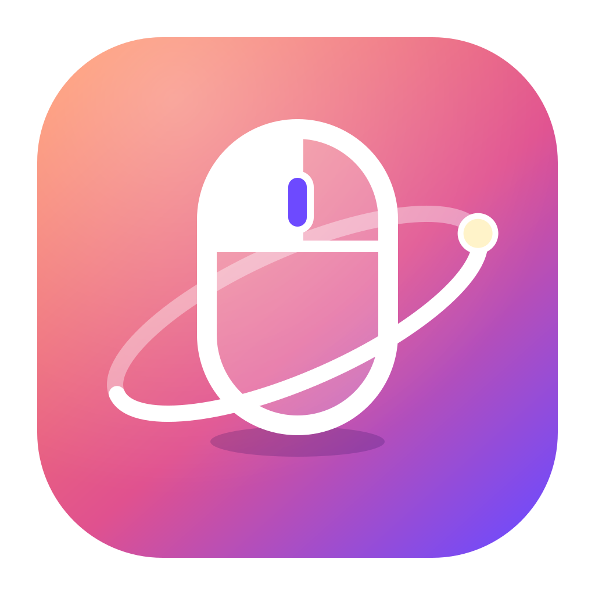
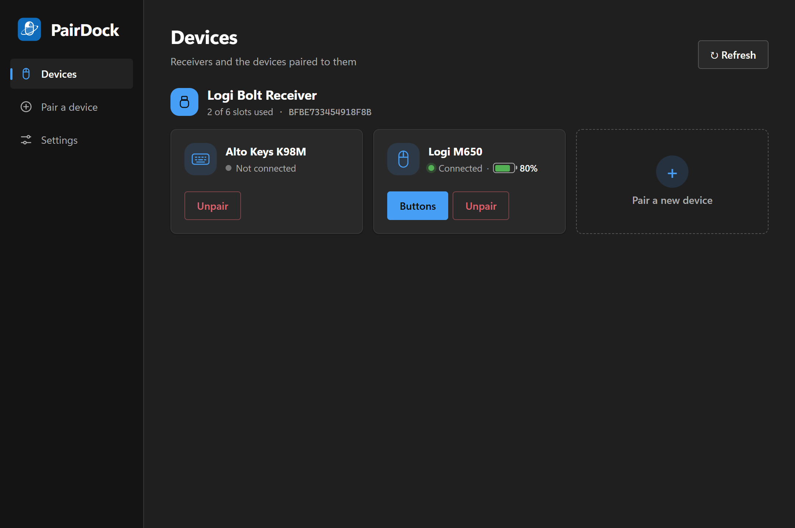

  

<h1 align="center">PairDock</h1>

  为罗技接收器配对鼠标和键盘、自定义按键—— 
  不需要安装 Logi Options+。

  <a href="https://github.com/n2ns/pairdock/releases/latest"><b>下载</b></a> ·
  <a href="docs/user-guide.zh-CN.md">操作手册</a> ·
  <a href="PRIVACY.zh-CN.md">隐私说明</a> ·
  <a href="README.md">English</a>

  
  

## 为什么做 PairDock

Logi Options+ 是一个庞大的套件，带着后台服务、自动更新、账号、云端功能和使用数据统计。如果你只是想把鼠标或键盘配对到接收器、改几个按键，PairDock 只做这些事：

- **小巧**：安装包约 3 MB，运行时只有一个托盘程序。
- **不需要罗技软件和驱动**：直接通过 Windows 或 macOS 自带的 HID 驱动和接收器通信。
- **注重隐私**：不需要账号，不收集任何数据；唯一的联网是到 GitHub 检查更新，可以关闭。详见[隐私说明](PRIVACY.zh-CN.md)。
- **不会阻止关机**：Windows 关机时立即响应，不会出现"某程序阻止关机"。

## 功能

**配对引导**：让设备进入配对模式，从列表里选中它，然后照着图示操作。PairDock 会高亮下一步要点的鼠标按键（左键、右键，最后左右键同时按），键盘则高亮要输入的数字。

  

**按键自定义**：在鼠标的俯视图或侧视图上选中一个按键，再选择它的功能：

| 动作 | 效果 | 需要 PairDock 运行 |
|---|---|---|
| 默认 | 按键的出厂功能 | 不需要 |
| 改成其他按键 | 执行另一个按键的功能，设置保存在鼠标上 | 需要在托盘中运行 |
| 快捷键 | 按住时发送组合键，如 `Ctrl+C`、`Alt+Left` | 需要在托盘中运行 |
| 禁用 | 按键不再有任何作用 | 需要在托盘中运行 |

  

**其他功能**：显示已连接设备的电量、解除配对、清理设备重复配对后留下的旧槽位、浅色和深色主题、中英文界面。

## 系统要求

- Windows 10 或 11（64 位），需要 Microsoft Edge WebView2 运行时（Windows 11 已自带）；或者 macOS（已在 Intel Mac 的 macOS 15 Sequoia 上测试）。
- **Logi Bolt** USB 接收器，以及带 Bolt 标志的设备。

| | 状态 |
|---|---|
| Logi Bolt 接收器 | 支持 |
| 罗技 Unifying 接收器 | 能识别，暂不支持（已列入计划） |
| 鼠标配对与按键设置 | 已用 Logi M650 实测 |
| 键盘配对 | 已实现，尚未在实物上测试 |
| macOS | 配对、解除配对和按键设置已在 Intel Mac（macOS 15）上实测；尚未测试的部分见[操作手册的 macOS 一节](docs/user-guide.zh-CN.md#macos) |
| Linux | 暂不支持，代码结构已为它预留 |

## 安装

1. 从[最新发布](https://github.com/n2ns/pairdock/releases/latest)下载 `PairDock_x.y.z_x64-setup.exe`。
2. 运行安装程序。安装包暂时还没有代码签名，Windows SmartScreen 可能会提示"Windows 已保护你的电脑"，点击**更多信息 → 仍要运行**即可。
3. 如果装了 Logi Options+，请先退出或卸载它，否则两个程序会争抢同一组按键。

macOS 用户请下载 `PairDock_x.y.z_aarch64.dmg`（Apple 芯片）或 `PairDock_x.y.z_x64.dmg`（Intel），打开后把 PairDock 拖进"应用程序"。应用暂时没有 Apple Developer ID 签名，首次打开需要点"仍要打开"，发送快捷键还需要"辅助功能"权限，步骤见[操作手册](docs/user-guide.zh-CN.md#macos)。

接下来请看[操作手册](docs/user-guide.zh-CN.md)。

## 常见问题

**支持其他品牌的鼠标键盘吗？** 不支持。配对和按键设置用的是罗技私有的 HID++ 协议，只有罗技的接收器和设备能识别。任何品牌的蓝牙设备，都可以直接在 Windows 的蓝牙设置里配对。

**卸载 PairDock 后，设备还会保持配对吗？** 会。配对信息保存在接收器里，不在电脑上。

**关闭 PairDock 后快捷键还有效吗？** "快捷键"和"禁用"需要 PairDock 在托盘（macOS 上是菜单栏）中运行。"改成其他按键"虽然保存在鼠标上，但鼠标重新连接后会丢失，要靠 PairDock 重新设置。关闭窗口时 PairDock 会留在托盘中；要彻底退出，请用托盘菜单里的 **Quit**，退出前会先把按键还原。

## 参与贡献

最有帮助的是附上设备型号和协议日志的问题报告。如何录制协议日志、如何从源码构建，见 [CONTRIBUTING.md](CONTRIBUTING.md)（英文）。

## 许可证

[MIT](LICENSE)。内置的 `crates/hidpp` 采用 0BSD 许可证，见[说明](crates/hidpp/NOTICE.md)。

PairDock 是独立项目，与罗技公司无关，也未获其认可。"Logitech"、"Logi"、"Logi Bolt"、"Unifying" 和 "Logi Options+" 是罗技公司的商标。
