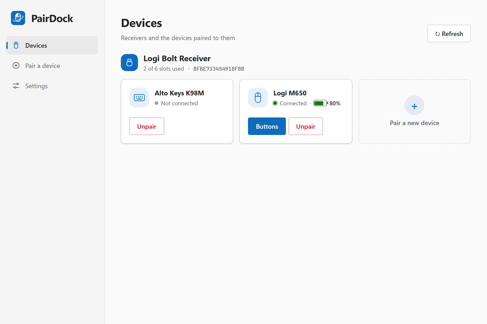
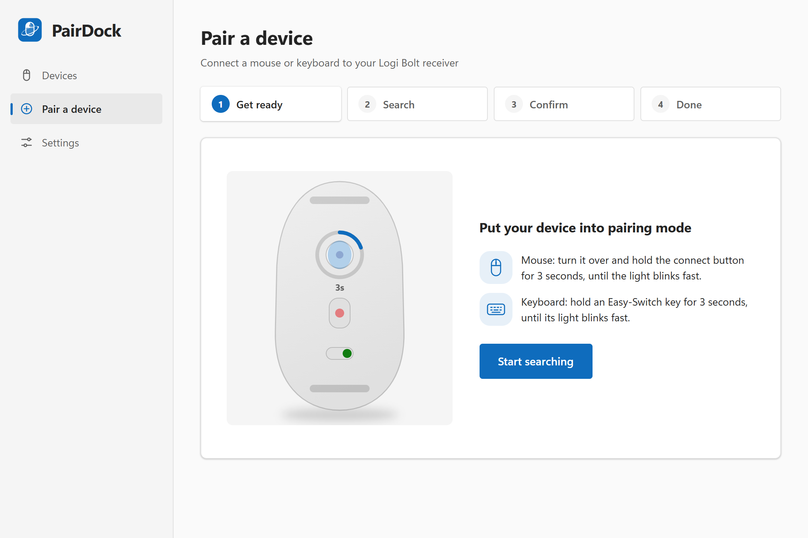
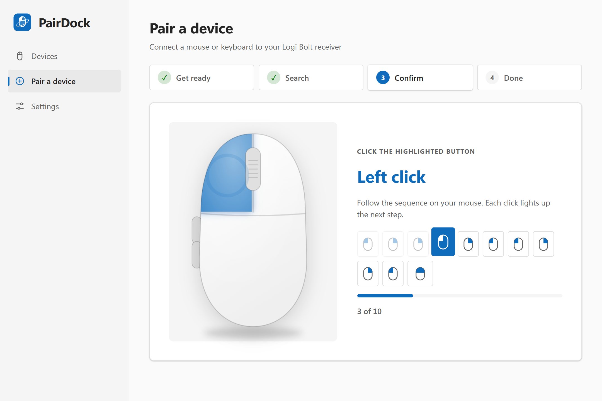
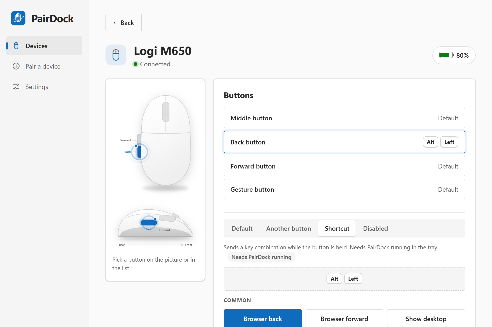

# PairDock user guide

[简体中文](user-guide.zh-CN.md)

- [First start](#first-start)
- [The device list](#the-device-list)
- [Pairing a device](#pairing-a-device)
- [Unpairing a device](#unpairing-a-device)
- [Customizing buttons](#customizing-buttons)
- [Settings](#settings)
- [The tray and quitting](#the-tray-and-quitting)
- [macOS](#macos)
- [Troubleshooting](#troubleshooting)
- [Uninstalling](#uninstalling)

## First start

1. Plug in your Logi Bolt receiver.
2. If Logi Options+ is installed, quit it from its tray icon or uninstall it. Otherwise both
   programs handle the same buttons and shortcuts may fire twice or not at all.
3. Start PairDock from the Start menu. It opens on the device list.

PairDock keeps running in the system tray (the blue mouse icon near the clock) after you close
its window. That is how button shortcuts keep working.

## The device list

Each receiver is listed with how many of its six slots are used and its unique ID. Below it,
every paired device shows:

- **Connected**, with its battery level, when the device is awake and in range.
- **Not connected** when it is asleep, switched off, out of range — or when the slot is an old
  pairing the device no longer uses (see [Old pairings](#old-pairings)).

Wake a device by moving the mouse or pressing a key, then press **Refresh**.

## Pairing a device

You can pair up to six devices to one Logi Bolt receiver. Open **Pair a device** in the sidebar,
or click **Pair a new device** in the device list.

### 1. Get ready

Put the device into pairing mode:

- **Mouse**: turn it over and hold the connect button for about 3 seconds, until its light
  blinks fast.
- **Keyboard**: hold an Easy-Switch key (usually F1–F3 or a key with a computer symbol) for
  about 3 seconds, until its light blinks fast.

If you have more than one receiver, pick the one to pair to. Then click **Start searching**.

### 2. Search

Devices in pairing mode appear within a few seconds. Click **Pair** next to yours. PairDock
keeps searching until you pick a device or leave the page.

### 3. Confirm

Bolt devices confirm the pairing with a short code, so that nobody nearby can connect a device
to your receiver.

- **Mouse**: click the highlighted button — left or right — following the sequence of ten
  steps. The picture and the row of small icons show the next click; the progress bar counts
  your clicks. After the tenth click, **press left and right together** and hold for half a
  second.
- **Keyboard**: type the digits shown on screen, then press **Enter**. The next digit is
  highlighted.

An extra click, a wrong key or waiting too long makes the receiver stop. Put the device back
into pairing mode and click **Try again**.

### 4. Done

The device is paired. For a mouse, **Customize buttons** takes you straight to its buttons.

#### Old pairings

When you pair a device that was already paired to the same receiver, the receiver keeps the old
slot as well; the device only uses the new one. PairDock recognizes this by the device's serial
number and offers **Remove old pairing** on the success screen. Removing it frees the slot.

You can also remove such a slot later from the device list: it is the copy of the device that
always shows **Not connected**.

## Unpairing a device

Click **Unpair** on the device and confirm. The device stops working with this receiver until
you pair it again.

## Customizing buttons

Click **Buttons** on a connected mouse.

Pick a button on the top view, on the side view (for the back and forward buttons) or in the
list. The selected button lights up, and a small dot marks buttons you have changed. Then choose
what it does:

| Action | What it does |
|---|---|
| **Default** | The button's original function. |
| **Another button** | The button performs another button's action, for example *Back → Middle button*. The mouse stores this itself, but forgets it when it reconnects, so PairDock sets it again. Needs PairDock running in the tray. Only buttons the mouse allows are offered. |
| **Shortcut** | The button sends a key combination while you hold it. Pick one of the common shortcuts, or click **Record** and press the combination. Needs PairDock running in the tray. |
| **Disabled** | The button does nothing. Needs PairDock running in the tray. |

Changes apply immediately and are saved. Settings belong to the mouse model, so another mouse of
the same model gets the same buttons.

Windows often acts on combinations with the Windows key (such as `Win+D`) before PairDock can
record them; pick those from the common shortcuts instead.

Which buttons can be customized depends on the mouse. On a Logi M650 these are the middle
button, the back and forward buttons and the gesture button. Left and right clicks cannot be
changed.

## Settings

- **Launch at startup**: PairDock starts in the tray when you sign in, so shortcuts work
  right away.
- **Appearance**: follow the Windows theme, or always use light or dark.
- **Language**: follow Windows, or always use 中文 or English.
- **Check for updates at startup**: on by default. When a newer version is on GitHub,
  PairDock asks whether to install it; nothing is downloaded until you click **Install and
  restart**. Installing returns the buttons to their defaults, runs the installer and starts
  PairDock again, which applies your button settings again; the settings themselves are kept.
- **Updates → Check for updates**: checks right away. See [PRIVACY.md](../PRIVACY.md) for what
  the check sends.
- **Source code on GitHub** and **Star on GitHub** open the project page in your browser.

## The tray and quitting

- Clicking the tray icon opens the window. Closing the window keeps PairDock in the tray.
- **Quit** in the tray menu exits PairDock. Before it exits, it returns every button to its
  default, so the mouse works normally without PairDock. A sleeping mouse only receives this
  once it wakes, so PairDock waits up to three seconds.
- When Windows shuts down, PairDock exits at once; the mouse starts fresh the next time the
  receiver powers up.

The tray menu is in English only for now: **Open PairDock** (opens the window) and **Quit**.

## macOS

PairDock works the same way on a Mac, with these differences. It was tested on macOS 15
Sequoia on an Intel Mac; see [Not tested yet](#not-tested-yet-on-macos).

### Installing and the first start

1. Download `PairDock_x.y.z_aarch64.dmg` for a Mac with Apple silicon or
   `PairDock_x.y.z_x64.dmg` for an Intel Mac, open it and drag **PairDock** into
   **Applications**.
2. Open PairDock. It is not signed with an Apple Developer ID or notarized yet, so macOS blocks
   the first start. Open **System Settings → Privacy & Security**, scroll down, click
   **Open Anyway** and confirm with **Open**
   ([Apple's instructions](https://support.apple.com/102445)). Later starts work normally.

### The menu bar

PairDock lives in the menu bar, not in the Dock. Click its icon (a mouse with an orbit) for the
menu: **Open PairDock** and **Quit**. Closing the window keeps PairDock running; opening
PairDock again from Applications shows the window.

### Allowing shortcuts

macOS lets an app send key presses only with the **Accessibility** permission. Pairing,
**Another button** and **Disabled** work without it.

1. Choose **Shortcut** for a button. PairDock shows a notice when the permission is missing.
2. Click **Allow…**, then **Open System Settings** in the dialog that appears.
3. Under **Privacy & Security → Accessibility**, turn on **PairDock**.

The notice disappears within two seconds and shortcuts work right away, without restarting
PairDock.

**After every update you have to allow it again.** Without a Developer ID signature, macOS
treats each new version as a different app, and the old switch no longer applies even though
it may still show as on. Remove PairDock from the list with the **−** button (or run
`tccutil reset Accessibility dev.pairdock.desktop` in Terminal), then follow the steps above.

### Shortcuts

The common shortcuts use the Mac keys: **Copy** `Cmd+C`, **Paste** `Cmd+V`, **Undo** `Cmd+Z`,
**Browser back / forward** `Cmd+[` / `Cmd+]`, **Show desktop** `F11`,
**Mission Control** `Ctrl+Up` and **Screenshot** `Cmd+Shift+4`. Recorded shortcuts are shown
with **Cmd** and **Option**.

Letters and digits are sent as the keys in those positions on a US keyboard, the way macOS
numbers its keys. With a layout that moves letters, such as AZERTY or Dvorak, a common shortcut
like `Cmd+Z` presses the key where Z is on a US keyboard.

### Quitting

**Quit** in the menu returns every button to its default before PairDock exits, as on Windows.

### Uninstalling

Turn off **Launch at startup** in Settings, quit PairDock and drag it from Applications to the
Trash. To remove every trace, also delete:

- `~/Library/Application Support/dev.pairdock.desktop` — button settings (`config.json`)
- `~/Library/WebKit/dev.pairdock.desktop` and `~/Library/Caches/dev.pairdock.desktop` — window
  data (language and appearance)
- `~/Library/LaunchAgents/PairDock.plist` — the startup entry, if it is still there

and remove PairDock from **System Settings → Privacy & Security → Accessibility**.

### Not tested yet on macOS

- Macs with Apple silicon.
- **Launch at startup**.
- Installing an update from the window.
- Pairing a keyboard (not tested on Windows either).

## Troubleshooting

**"No Logitech receiver found"** — Plug the receiver into a USB port on the computer and
click **Refresh**. Unifying receivers are detected but cannot be used yet.

**"The device is asleep"** — Move the mouse or press a key on the keyboard, then click
**Try again**.

**The device does not show up while searching** — Make sure its light blinks fast; pairing mode
ends after a while. Hold the connect button again. Bolt devices only appear for Bolt receivers.

**Pairing fails at the last step** — Press both mouse buttons at exactly the same moment. If
one is pressed slightly earlier, it counts as an extra click.

**Shortcuts stopped working** — PairDock must be running: look for its tray icon, or start it
again. If Logi Options+ is running too, quit it.

**Shortcuts do nothing in one particular window** — Windows does not let programs send key
presses to windows that run as administrator, such as Task Manager
([SendInput](https://learn.microsoft.com/windows/win32/api/winuser/nf-winuser-sendinput)).
PairDock's shortcuts work again as soon as another window is active.

**A button does nothing after PairDock crashed** — PairDock could not return the button to its
default. Start PairDock and quit it from the tray, or switch the mouse off and on.

**Windows SmartScreen blocks the installer** — The installer is not code-signed yet. Click
**More info → Run anyway**.

If none of this helps, please [open an issue](https://github.com/n2ns/pairdock/issues/new/choose)
with your device model. [CONTRIBUTING.md](../CONTRIBUTING.md) explains how to record a protocol
trace that lets us see what the receiver answered.

## Uninstalling

Uninstall PairDock from **Settings → Apps → Installed apps** in Windows. Your devices stay paired
to the receiver.

PairDock keeps its files in two folders, which you can delete to remove every trace:

- `%APPDATA%\dev.pairdock.desktop` — button settings (`config.json`)
- `%LOCALAPPDATA%\dev.pairdock.desktop` — window data (language and appearance)
